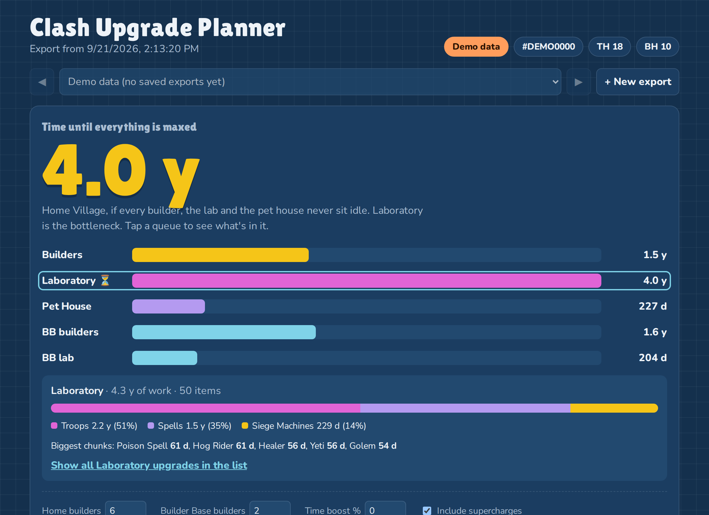
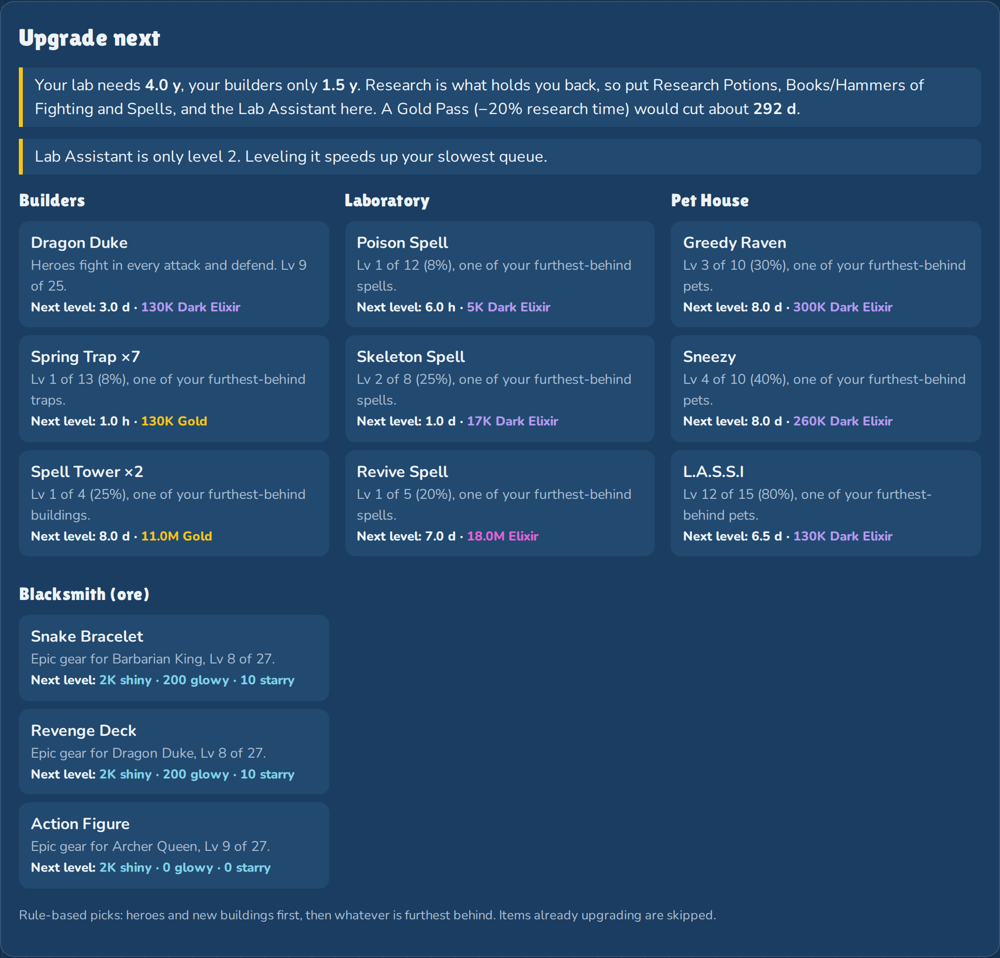
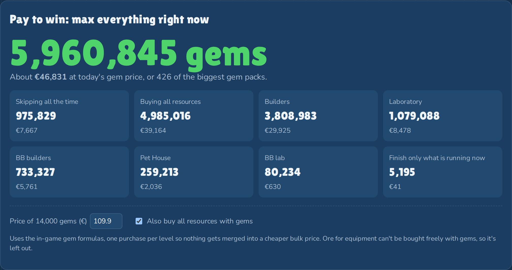
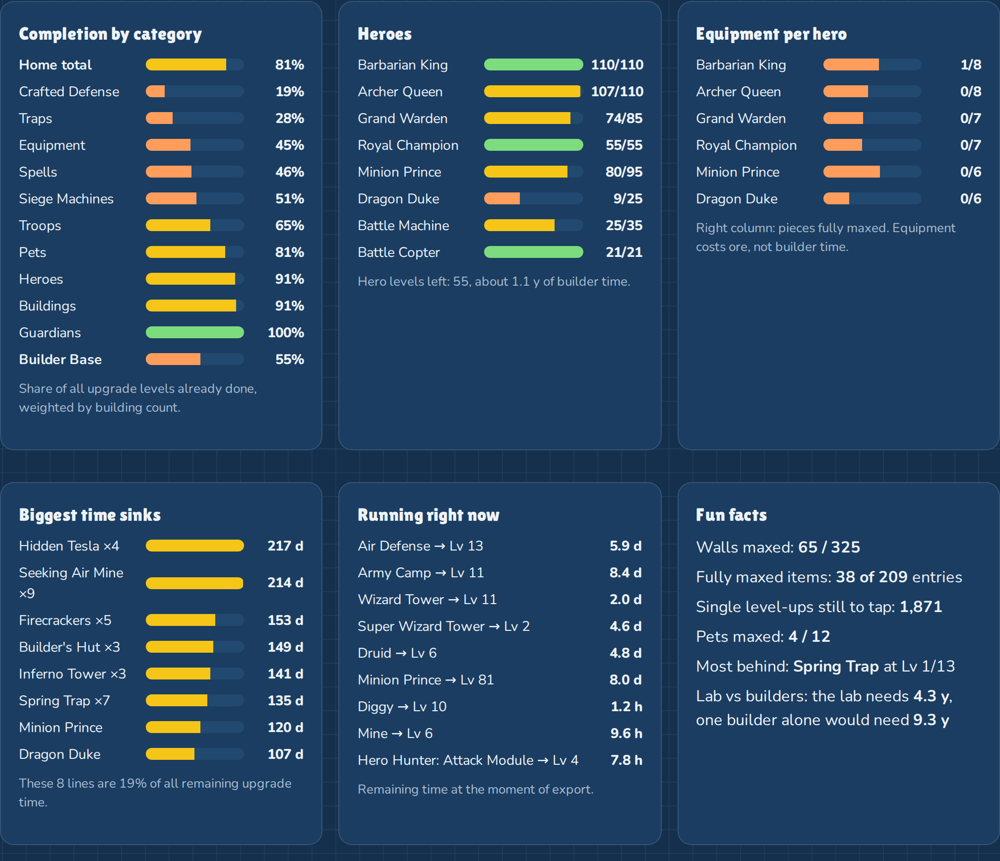
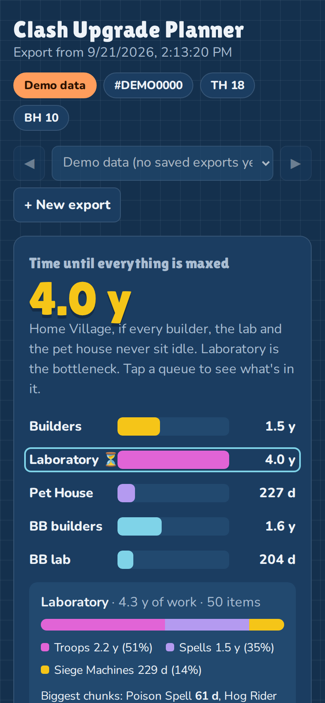

<div align="center">

# 🏰 Clash Upgrade Planner

**See exactly what's left to max your Clash of Clans village and how long it will really take.**

Copy your data export from the game, paste it in, done. No login, no API key, no connection to the game.




<sub>Screenshots show a demo account with made-up data.</sub>

</div>

---

## Why

The game tells you what you *can* upgrade next. It doesn't tell you how far you are from maxed, which queue is actually holding you back, or what all of it would cost. This planner reads the data export Clash of Clans already gives you and turns it into a full plan.

## Features

- ⏳ **Time to max**: real wall-clock estimate per queue (Builders, Laboratory, Pet House, Builder Base) and which one is your bottleneck
- 🔍 **Queue breakdown**: tap a queue to see what's inside it (e.g. Lab = troops / spells / siege machines) and the biggest time sinks
- 🎯 **Upgrade next**: top picks for Builders, Lab, Pet House and Blacksmith, each with the reason and the cost of the next level
- 💰 **Resources still needed**: Gold, Elixir, Dark Elixir, Ore, Builder Base resources
- 💎 **Pay to win**: how many gems (and roughly how much money) it would take to max everything right now
- 🧪 **Magic items**: enter your potions, books and hammers; the planner puts each book/hammer on the upgrade where it saves the most time
- 🧑‍🔧 **Helpers**: Builder's Apprentice and Lab Assistant levels from your export are included automatically
- 📊 **Stats**: completion per category, heroes, equipment per hero, what's upgrading right now, fun facts
- 🗂️ **Saved exports**: every export is saved by date. Jump back to older ones and see your progress since the last export (levels done, days closer to max). Backup and restore included
- 📋 **Full upgrade list**: filter by category, queue and village; search and sort
- 📱 Works on phone and desktop, light and dark mode

| Upgrade next | Pay to win |
|---|---|
|  |  |

| Stats | Mobile |
|---|---|
|  |  |

## How to use

1. **Open the planner**: double-click `index.html` in the main folder (or use the GitHub Pages link of this repo, if enabled). Don't open `src/template.html`, that's only the build template.
2. **Copy your data in Clash of Clans**: Settings → More Settings → scroll down to **Data Export** → tap **Copy**.
3. **Paste it**: at the bottom of the planner, open **Load your own export**, paste the text and tap **Analyze export**.

That's it. Each export is saved by date in your browser. Use the ◀ ▶ arrows or the dropdown at the top to jump between them, and **+ New export** to add the next one. Multiple accounts work too.

> Saved exports live in your browser's storage. Use **Download backup** now and then, and paste the backup file's content into the box to restore it (for example on another device).

> The export contains no password or login data. Still, there's no reason to post it publicly.

## Supported game version

| | |
|---|---|
| Town Hall | up to **18** |
| Builder Hall | up to **10** |
| Game data | September 2026 game update |
| Tested exports | **iOS** ✅ |
| Android | not tested yet. If you try it, please open an issue with the result |

New game updates (new levels, troops, equipment) need a data update. **Updates will follow when a new game version is out.** Items the planner doesn't know yet are listed at the bottom of the page instead of breaking anything.

## Privacy

- Runs completely in your browser. Nothing is uploaded anywhere.
- No account, no API key, no live connection to the game or to Supercell.
- Your pasted export and magic-item counts are stored only in your browser's local storage.
- The page loads two web fonts from Google Fonts; everything else is inside the single `index.html`.

## How the numbers work

- Max levels are capped at your current Town Hall.
- Builder time is divided by your number of builders; Lab and Pet House are single queues.
- Upgrades running at export time use their remaining time.
- Merged defenses are handled (Ricochet Cannon, Multi-Archer Tower, Multi-Gear Tower, Super Wizard Tower, Eagle Artillery → Town Hall 17).
- Gem prices use the in-game gem formulas, calculated per level. Ore can't be freely bought with gems, so it's not included.
- Recommendations are rule-based (heroes and new buildings first, then whatever is furthest behind). They don't know which army you use.

## Project structure

```
index.html               ready-to-use planner (built file)
src/template.html        page layout, styles and UI logic
src/analyze.js           turns an export into upgrades, queues and costs
src/gamedata.json        game data (levels, times, costs)
src/demo-account.json    made-up demo account
src/build.py             builds index.html from the files above
docs/screenshots/        images for this README
```

Rebuild after changing anything in `src/`:

```bash
python src/build.py
```

## Contributing

Contributions are welcome: bug reports, Android test results, data updates for new game versions, ideas. See [CONTRIBUTING.md](CONTRIBUTING.md).

## License

© 2026 [saxcodez](https://github.com/saxcodez)

Licensed under the [PolyForm Noncommercial License 1.0.0](LICENSE.md). You may use, study, change and share this project and contribute to it, **but not for any commercial purpose**: no selling, no paid versions, no making money with it. See [NOTICE](NOTICE) for details, including the license of the bundled game data.

## Disclaimer

This material is unofficial and is not endorsed by Supercell. For more information see Supercell's Fan Content Policy: [www.supercell.com/fan-content-policy](https://www.supercell.com/fan-content-policy).

Clash of Clans is a trademark of Supercell Oy. This project is not affiliated with, sponsored by or connected to Supercell in any way. It only reads the data you copy and paste yourself.
